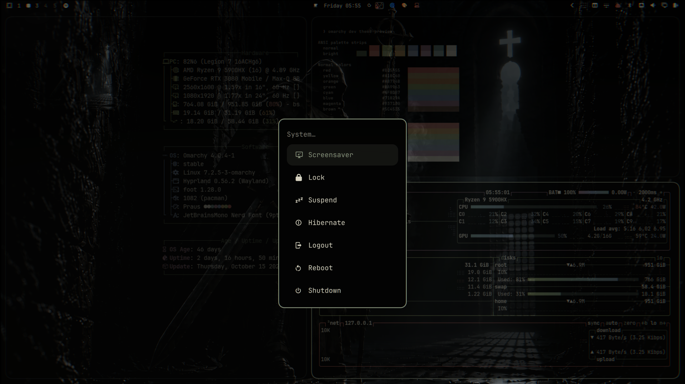

# Praus

> Praus means meekness. A great warrior knows when to draw his sword and does not exert his power upon others unless called upon to do so. Submission of the will and humility are what allows the great ones to serve.
>
> — Parker Brown

An Omarchy theme for the Eastern warrior-monk: Vantablack's black, olive cloth, linen text, and a little bronze.



## Install

```
omarchy theme install https://github.com/parker-brown-family/omarchy-praus-theme
```

Omarchy names it `praus` and applies it on install. Later:

```
omarchy theme set praus
```

It is a colours-only theme. The terminal, btop, Neovim, Hyprland borders, the bar and the lock screen all come from [`colors.toml`](colors.toml) through Omarchy's own templates.

## Palette

| Colour | Hex | Where it lands | On black |
|---|---|---|---|
| Vantablack | `#000000` | every surface | — |
| Iron | `#292F2B` | unfocused window borders | surface only |
| Monastic olive | `#536049` | comments, dim text | 3.14:1 |
| Worn sage | `#86917B` | accent, the focused window | 6.35:1 |
| Aged linen | `#D4D0BF` | body text | 13.57:1 |
| Ancient bronze | `#A18C60` | warnings, search matches | 6.44:1 |
| Dried blood | `#B05F55` | errors, bar alerts | 4.61:1 |

Dried blood started as `#813B35`, which measures 2.61:1 on black and cannot be read as error text, so the terminal red is lifted. The other terminal colours (verdigris, slate iron, bruised wine, leather, and the lamp flame as bright yellow) are derived to sit on the same material and measure 4.9:1 to 6.8:1.

## Backgrounds

1. **The Meek Warrior** — the primary
2. **The Cell**
3. **The Lamp**
4. **ΠΡΑΫΣ** — the word, set in Noto Serif Display

The three paintings were made for this theme by Parker Brown with ChatGPT in October 2026, then graded onto the palette's black and upscaled to 3840×2160. The originals, the type source and the exact grade are in [`art/`](art/).

## License

MIT, covering the theme and its wallpapers. See [`LICENSE`](LICENSE).
